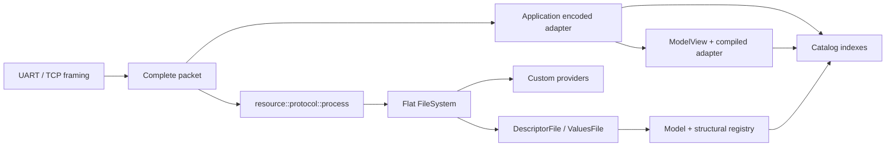

# Telemetry

Оберіть точку входу за своїм завданням:

| Потрібно | Звідки почати |
| --- | --- |
| Описати свій пристрій і викликати Field / Command / Service локально | [Перша інтеграція](doc/user/GettingStarted.md), [NativeOnly.cpp](examples/user_guide/NativeOnly.cpp) |
| Віддалені виклики з відомими типами та Codec; Generated SDK необов'язковий | [Асинхронний DeviceClient](doc/AsyncClient.md) |
| Віддалений клієнт для невідомих наперед структур | [RuntimeSchema](doc/RuntimeSchema.md) → [DynamicClient](doc/DynamicClientUsage.md) |
| Запустити готовий універсальний GUI | [Qt/QML Inspector: Demo, TCP або UART](examples/inspector_qml/README.md) |
| Редагувати Field і прочитати застосоване значення | [FieldWrite Workbench: Writable demo та TCP](examples/inspector_qml/README.md#read-edit-write-and-refresh) |
| Виконати Command через універсальну форму аргументів | [Command Workbench: аргументи та Execute](examples/inspector_qml/README.md#command-arguments-and-execute) |
| Викликати Service і переглянути відповідь без Generated SDK | [Service Workbench: Request та Response](examples/inspector_qml/README.md#service-requests-and-responses) |
| Підключити NUCLEO-H7S3L8 через UART/DMA | [Прошивка плати](examples/nucleo_h7s3l8/README.md), [serial-збірка Inspector](examples/inspector_qml/README.md#nucleo-h7s3l8-through-st-link-serial) |
| Підключити окремі модулі до CMake або qmake | [Модулі, залежності та build targets](doc/Modules.md) |

[Усі приклади та їхні точки збирання](examples/README.md).
`CMakeLists.txt` у корені збирає бібліотеку; `telemetry.pro` — окремий
[Qt Widgets playground](app/README.md). Для Universal Inspector відкривайте
`examples/inspector_qml/CMakeLists.txt`.

[](https://github.com/shpegun60/telemetry/actions/workflows/ci.yml)
[](lib/telemetry/README.md)
[](doc/Architecture.md)
[](lib/boost_pfr/VERSION.md)
[](LICENSE)

**Native C++20 телеметрія для мікроконтролерів:** прив'яжіть звичайний getter,
setter або метод класу; типи, wire codec і спільний реєстр формуються автоматично.
Field, Command і Service мають одну модель декларації: **назва + binding**.
Native API не потребує генератора коду, virtual base class або динамічного виділення пам'яті
в library core. Qt використовується в host-прикладах та необов'язковому QML SDK.

Необов'язковий [host-side генератор C++/TS/JS SDK](doc/CodeGenerator.md) читає
Descriptor v3.0 та створює готові типи, endpoint contracts і standalone кодеки.
Вони працюють із власним транспортом, Encoded API або чинним RpcClient;
оригінальні структури STM32 та wire-контракти залишаються чинними.
Додатковий [QML target із C++ backend](doc/GeneratedQmlApi.md) створює готовий
Qt 6 модуль: кешовані властивості, `NOTIFY` та асинхронні Field/Command/Service.
Є [Qt Quick приклад](examples/codegen_qml/README.md) і
[перевірки на справжньому QML runtime](tests/codegen_qml/README.md).

**[API Map: Native / Encoded / Codec / Resource](doc/user/APIOverview.md)** ·
[Посібник користувача](doc/user/README.md) ·
[Перша інтеграція](doc/user/GettingStarted.md) ·
[Native API](doc/user/NativeApi.md) ·
[Транспорт і файли](doc/user/TransportAndResources.md) ·
[Приклади](examples/user_guide/README.md) ·
[Перевірки](tests/README.md)

Швидко згадати виклики: [API шпаргалка](doc/user/API-CHEATSHEET.md).
Runtime native `callAs`, Field borrowing, докладні read statuses та плоский
обхід з ID: [практичний посібник](doc/user/Ergonomics.md).
Для Command/Service із одним result: [flat runtime API](doc/user/FlatNative.md)
та [повна програма](examples/user_guide/FlatNative.cpp).

**Ключові слова:** C++20 · compile-time reflection · Boost.PFR · magic_enum ·
STM32 · embedded · native C++ · Field / Command / Service · zero heap ·
canonical little-endian · UART / TCP · COBS.

Boost.PFR зафіксований на **boost-1.92.0**. На 2026-10-04 це відповідає
[останньому стабільному релізу Boost](https://www.boost.org/releases/latest/);
повний Boost не потрібний. [Походження та SHA-256](lib/boost_pfr/VERSION.md).

## Навігація

- [Як організувати свій протокол](#як-організувати-свій-протокол)
- [Як пройти першу інтеграцію](#як-пройти-першу-інтеграцію)
- [Довідник за API](#довідник-за-api)
- [Почати з готової програми](#почати-з-готової-програми)
- [Який API вибрати](#який-api-вибрати)
- [Типи й прив'язки](#типи-й-привязки)
- [Файли або прямий доступ](#файли-або-прямий-доступ--обидва-варіанти)
- [Пам'ять і build integration](#память-і-build-integration)
- [Перевірки та вимірювання](#перевірки-та-вимірювання)
- [Структура й ліцензія](#структура-й-ліцензія)

## Як організувати свій протокол

**[Готовий приклад власного протоколу для UART/TCP](examples/device_integration/README.md)**
показує весь шлях: chunks → повний frame → операція → відповідь. У
[Api.cpp](examples/device_integration/Api.cpp) є обробник і збирач потоку, у
[Api.hpp](examples/device_integration/Api.hpp) — коди операцій та runtime facade.
Один маршрут читає/записує Fields і викликає Commands/Services **без файлів**;
інший передає файлові LIST/STAT/READ/WRITE у `resource::protocol::process()`.
Приклад можна зібрати й запустити на host без Qt та пристрою.

[Транспортний посібник](doc/user/TransportWalkthrough.md) пояснює таблиці
операцій, значення статусів, формати пакетів і приклади байтів. Framing цього
прикладу можна замінити своїм; telemetry core від нього не залежить.

Для чинного sibling COBS є окремі
[integration guide](doc/user/COBSIntegration.md) і
[повний host project](examples/cobs_integration/README.md). Він передає
resource packets через реальний `cobs::Endpoint`, демонструє pending TX
ownership, backpressure та recovery; host transport у ньому є fake.

## Як пройти першу інтеграцію

1. [Зібрати першу програму](doc/user/GettingStarted.md): залежності, include
   paths, compiled sources, власний клас, таблиці й перші native виклики.
2. [Підключити до свого застосунку](doc/user/ApplicationIntegration.md):
   business validation, status, всі форми binding, slots, snapshots і tasks.
3. [Провести дані через transport](doc/user/TransportWalkthrough.md): UART/TCP
   chunks → complete frame → telemetry або files → reply, у готовому прикладі.
4. [Зібрати multi-file device example](examples/device_integration/README.md):
   `Device.cpp`, приховані каталоги у `Api.cpp`, bounded receiver і host feeder.
5. Якщо щось не працює — [питання та діагностика](doc/user/Troubleshooting.md).

Ці розділи читаються послідовно. [Native API](doc/user/NativeApi.md) і
[Транспорт і ресурси](doc/user/TransportAndResources.md) лишаються довідниками
точних signatures та contracts, до яких можна звернутися за конкретним питанням.

## Довідник за API

| Потрібно | Окрема сторінка |
| --- | --- |
| Вибрати сценарій, public header і готову програму | [API Map](doc/user/APIOverview.md) |
| Getter/setter, exact/As access і owning/borrowed Field result | [Fields](doc/user/Fields.md) |
| Application дія, Request, statuses і повторне виконання | [Commands](doc/user/Commands.md) |
| Request/Response, status та owning/borrowed Service result | [Services](doc/user/Services.md) |
| Local tables, named groups, PackedId, traversal та indexes | [Tables and catalogs](doc/user/TablesAndCatalogs.md) |
| Спільний TypeRegistry, ModelView та encoded adapter | [Model](doc/user/Model.md) |
| Великий проєкт: compiler memory/time, type diversity та module boundaries | [Вимірювання масштабування](doc/Scalability.md) |
| Canonical bytes, три decode forms, Workspace/Lease, local budget та overlap | [Codec and Workspace](doc/user/CodecAndWorkspace.md) · [Runnable приклад](examples/user_guide/Codec.cpp) |
| Providers, FileSystem/FileView, cursor і partial READ/WRITE | [Resource files](doc/user/Resources.md) |
| Immutable descriptor, live Values, fingerprint і buffers | [Descriptor and Values](doc/user/DescriptorAndValues.md) |
| Exact binary headers/records/default ceilings | [Wire v3.0](doc/WireV3.md) |
| Complete LIST/STAT/READ/WRITE packet processor | [Resource protocol](lib/resource/protocol/README.md) |
| Typed remote Field/Command/Service без ручного TRPC header | [RpcClient](doc/RpcClientV1.md) · [Приклад](examples/rpc_client/README.md) |
| Кілька незалежних клієнтів одного Model | [RpcSessionPool](doc/RpcSessionsV1.md) · [Приклад](examples/rpc_multi_session/README.md) |
| Реальний COBS Endpoint із telemetry resource packets | [COBS integration](doc/user/COBSIntegration.md) |

У кожній API сторінці є сигнатури, meaning результатів, lifetime та
посилання на повні приклади. [Документаційний індекс](doc/README.md)
також веде до module references, tests і measured evidence.

## Почати з готової програми

[NativeOnly.cpp](examples/user_guide/NativeOnly.cpp) — перший local Field,
Command і Service без створення Model, Workspace чи files. Він перевіряє
native calls, checked Field conversions та exact Command/Service signatures.
Для самостійного DTO ↔ bytes є [Codec.cpp](examples/user_guide/Codec.cpp).

[QuickStart.cpp](examples/user_guide/QuickStart.cpp) — повна програма без Qt і
приладу. Вона оголошує всі три сімейства, збирає Model і викликає native API.
Межа напруги нижче є бізнес-логікою `Device`, а не metadata бібліотеки.

<!-- quickstart:begin -->
```cpp
/*
 * Small native Fields, Commands and Services application.
 *
 * Start with ordinary owner methods and bind names directly to their signatures.
 * The static owner and tables satisfy borrowing lifetimes; semantic validation
 * stays in Device rather than the structural Model.
 *
 * Authors: Ruslan Kovtun (shpegun60), codexAi. SPDX-License-Identifier: MIT.
 */

#include <telemetry/Telemetry.hpp>
#include <cassert>
#include <cmath>
#include <limits>

namespace ts = telemetry;

struct Config {
	float voltage;
	bool enabled;
};

struct Snapshot {
	float voltage;
	bool enabled;
};

// Public methods:
// - read(): Copy current configuration.
// - write(): Apply validated configuration.
// - reset(): Restore example defaults.
// - sample(): Copy measurement snapshot.
struct Device {
	Config state{230.0f, true};

	Config read() const noexcept
	{
		return state;
	}

	ts::WriteResult write(const Config& next) noexcept
	{
		if (!std::isfinite(next.voltage) || next.voltage < 0.0f || next.voltage > 300.0f)
			return ts::WriteResult::InvalidValue;
		state = next;
		return ts::WriteResult::Applied;
	}

	ts::CommandResult reset() noexcept
	{
		state = {230.0f, true};
		return ts::CommandResult::Executed;
	}

	Snapshot sample() const noexcept
	{
		return {state.voltage, state.enabled};
	}
};

inline Device device;
inline constexpr ts::FieldTable localFields{
    ts::field<&Device::read, &Device::write>("Config", device)};
inline constexpr ts::CommandTable localCommands{ts::command<&Device::reset>("Reset", device)};
inline constexpr ts::ServiceTable localServices{ts::service<&Device::sample>("Sample", device)};
inline constexpr ts::FieldCatalogTable fields{ts::group("device", localFields)};
inline constexpr ts::CommandCatalogTable commands{ts::group("device", localCommands)};
inline constexpr ts::ServiceCatalogTable services{ts::group("device", localServices)};
inline constexpr ts::Model model{fields, commands, services};

int main()
{
	assert(localFields.write<0>(Config{240.0f, true}) == ts::WriteResult::Applied);
	const auto value = fields.read<ts::makeId<0, 0>()>();
	assert(value && value->voltage == 240.0f);
	assert(localFields.write<0>(Config{std::numeric_limits<float>::quiet_NaN(), false}) ==
	       ts::WriteResult::InvalidValue);
	const auto unchanged = localFields.read<0>();
	assert(unchanged && unchanged->voltage == 240.0f && unchanged->enabled);
	const auto response = services.call<ts::makeId<0, 0>()>();
	assert(response.hasValue() && response.value().voltage == 240.0f);
	assert(localCommands.call<0>() == ts::CommandResult::Executed);
}
```
<!-- quickstart:end -->

Зберігайте objects і names довше за таблиці. Callback має бути `noexcept`.
Для struct/array values використовуйте звичайні вирівняні DTO: codec передає
members у canonical little-endian формі, не C++ padding або raw memory layout.

## Який API вибрати

[API Map](doc/user/APIOverview.md) показує незалежні маршрути та їхні
залежності. Таблиця нижче допомагає згадати конкретний виклик.

| Що відомо у цьому місці | Приклад | Результат / поведінка |
| --- | --- | --- |
| Локальна позиція compile-time | `localFields.read<0>()`, `write<0>(value)` | Exact native type; concrete callback |
| Глобальний ID compile-time | `fields.read<ts::makeId<0, 0>()>()` | Compile-time routing у локальну таблицю |
| ID runtime, потрібен конкретний C++ тип | `fields.readAs<Config>(id)`, `writeAs(id, value)` | Exact structural type або checked numeric conversion |
| Runtime ID з native definition | `fields.visit(id, visitor)` | Typed visitor; перевірка вибраної definition |
| Команда/сервіс compile-time | `commands.call<id>(request)`, `services.call<id>(request)` | Native request/result, без wire encoding |
| ID + bytes отримані з транспорту | `index.readEncoded(...)`, `writeEncoded(...)`, `executeEncoded(...)`, `callEncoded(...)` | Checked canonical decode/callback/encode |
| C++ DTO ↔ bytes без endpoints | `ts::encode(object, bytes)`, `ts::decode(bytes, object)` | Standalone Codec; ні таблиці, ні Model не потрібні |
| Обхід concrete definitions | `table.forEach(visitor)`, `catalogs.forEach(visitor)` | Тип callback лишається відомим; getter сам не викликається |
| Обхід erased entries | `for (const auto& entry : table)` | Descriptor metadata без автоматичного виконання |
| Обхід файлів | `for (auto file : fs)` | Lazy `FileView`: `index()`, `path()`, explicit operations |

Глобальний ID — u32 з 16-бітними позиціями catalog/entry. Runtime lookup —
перевірка меж і пряме індексування масивів. Compile-time локальний/глобальний
шлях зберігає конкретну функцію; однаковість із прямим викликом перевіряється
ARM codegen gates для визначених fixtures, а не обіцяється для кожного compiler.

## Типи й прив'язки

- **Field:** getter повертає число, bool, enum, `std::array` або aggregate `T`;
  можливий `const T&`. Setter приймає той самий `T` або `const T&` і повертає
  `WriteResult`.
- **Command:** нуль аргументів або один aggregate Request, результат
  `CommandResult`.
- **Service:** нуль аргументів або один aggregate Request; aggregate Response
  за значенням/`const Response&`, `ServiceResult<Response>`,
  `BorrowedServiceResult<Response>` або void response.
- **Bindings:** free functions, member functions, callable objects, lambdas;
  [п'ять slots](lib/telemetry/slot/README.md) для пізнього вибору object/function.

`const T&` output не копіює payload: application гарантує його lifetime і
стабільність до завершення synchronous encode. `readAs<T>` навмисно повертає
owning copy. Raw pointer і mutable-reference outputs не є payload contract.
Читайте [borrowed outputs](doc/BorrowedNativeValues.md).

Units, limits, defaults, persistence й semantic metadata не входять у поточний
API. Валідація прикладних значень належить callback; structural validation —
codec. Перелік типів, enum dictionaries і callback forms докладно наведений у
[Native API](doc/user/NativeApi.md).

## Файли або прямий доступ — обидва варіанти

`resource` — незалежний flat filesystem. Оголосіть stable provider і додайте
`resource::file("/settings.bin", provider)` до `resource::filesystem(...)`.
Шлях є плоскою назвою: directories, storage або serializer не створюються
автоматично. `BytesFile` надає bytes зі stable array/span; власний provider
реалізує `size()` і `read()` та/або `write()`.



Для файлових packets:

```cpp
#include <resource/protocol/Protocol.hpp>
// request/response — spans повного packet та output storage.
auto result = resource::protocol::process(device::resources::files(), request, response);
// Надіслати response.first(result.written), перевіривши result.
```

`device::resources::files()` — **facade застосунку**, не global library function.
Повний приклад власного table/provider/process є в
[Resources.cpp](examples/user_guide/Resources.cpp). Для прямого керування
телеметрією **без файлів** є [Encoded.cpp](examples/user_guide/Encoded.cpp).
Файловий protocol робить LIST/STAT/READ/WRITE; запис Field або виклик
Command/Service виконує encoded catalog index або ModelView adapter. Descriptor/Values providers
саме read-only.

TCP/UART chunks спочатку збираються вашим framing layer у повний packet.
Операції synchronous; retries, connection state і coherent snapshots належать
застосунку. Необов'язковий [Bind/Exchange приклад](examples/structured_protocol/README.md)
показує bounded connection agreement без fingerprint у кожному data packet.

## Пам'ять і build integration

Immutable metadata може лежати у Flash, application/slot state — у RAM.
Encoded local storage budget типово **32 B**
(`TELEMETRY_STRUCTURED_LOCAL_BYTES`). Вибір storage відбувається при компіляції;
більші об'єкти використовують caller-owned `Workspace`. Service враховує
Request + actual result object разом. Budget змінює storage, не wire format
чи validation. Для native owning return великого об'єкта враховуйте stack
застосунку; borrowed outputs уникають result copy.

Для qmake:

```qmake
include(path/to/lib/telemetry/telemetry.pri)
# Необов'язкові Descriptor/Values providers:
CONFIG += resource_telemetry
# Окремо, лише якщо потрібний RPC mailbox:
# CONFIG += resource_telemetry_rpc
include(path/to/lib/integration/integration.pri)
```

Для іншого build system додайте include paths і compiled sources з
[telemetry README](lib/telemetry/README.md). Generic resource headers не
залежать від telemetry/PFR/Qt; packet processor компілюється окремо.
`Resource.hpp` не підключає packet protocol або telemetry adapter автоматично.
Прапорці providers незалежні: Descriptor/Values-only збірка не компілює RPC.
Для керування через файл є [RpcMailbox example](examples/rpc_mailbox/README.md).
Для typed вихідних викликів є [RpcClient](doc/RpcClientV1.md), а для N
незалежних server sessions — [RpcSessionPool](doc/RpcSessionsV1.md).
Client-only qmake підключає `lib/client/client.pri` із
`CONFIG += telemetry_client_rpc`; server-only
збірка не компілює `RpcClient.cpp`. Файли й transport залишаються optional.
Результати перевірок і межі доказів зібрано в
[RPC extensions qualification](doc/RpcExtensionsQualification.md).

Qt playground: відкрийте [telemetry.pro](telemetry.pro) встановленим Qt 6
MinGW kit. Він використовує симульовані дані; до приладу не підключається.
Про known clangd issue і перевірений editor executable читайте
[editor checks](tests/editor/README.md).

[Qt/QML Universal Inspector](examples/inspector_qml/README.md) працює без
Generated SDK: дерево endpoint-ів, асинхронне читання Field, точні 64-бітні
значення та порційний перегляд масивів. TCP-адаптер або optional UART/COBS-адаптер
завантажує Descriptor через Resource і читає поля пристрою через Encoded.
Для перевірки без плати є Demo device та локальний TCP-сервер із native Model;
Descriptor файл можна відкрити окремо для metadata. Для UART/DMA є готова
[прошивка NUCLEO-H7S3L8](examples/nucleo_h7s3l8/README.md).

## Перевірки та вимірювання

```sh
python tests/docs/run.py --cxx g++ --build-dir /tmp/telemetry-docs
python tests/run_checks.py --build-dir /tmp/telemetry-checks
python tests/resources/run.py --build-dir /tmp/telemetry-resources
```

[CI](https://github.com/shpegun60/telemetry/actions/workflows/ci.yml) перевіряє
GCC/Clang C++20, санітайзери, null-check mode, ARM compile/link/codegen/stack,
Qt consumers, API/wire freeze і compile/run приклади. Badge показує published
branch; локальні незапушені зміни мають окремі результати.
[Індекс тестів](tests/README.md) описує точні runners. ARM `.su` frame або
objdump не є виміром cycles/live stack: [H7S qualification](tests/structured/mcu/h7s/README.md)
і [збережені receipts](tests/resources/evidence/README.md) пояснюють source identity
та межі апаратних доказів.

## Структура й ліцензія

| Папка | Призначення |
| --- | --- |
| `lib/telemetry` | Єдиний public namespace `telemetry`: reflection, types, codec, endpoint tables, Model |
| `lib/resource` | Flat files and `resource::protocol` |
| `lib/integration` | Optional Descriptor/Values providers, RPC/TEQ1 servers and client backends |
| `web` | Strict descriptor/value codec для JavaScript |
| `examples` | Native, resource, protocol та Qt/browser clients |
| `doc/user` | Актуальний посібник користувача |
| `tests` | Підтримувані checks та evidence |
| `app` | Qt playground |

Власний код — [MIT](LICENSE). Included dependencies мають свої незмінені
ліцензії: [Boost.PFR](lib/boost_pfr/VERSION.md) — BSL-1.0,
[magic_enum](lib/magic_enum/README.md) і [delegate](lib/delegate/README.md) — MIT.
[Індекс документів](doc/README.md) відділяє user guide від історичних review,
планів і [міграції](doc/StructuredTelemetryV3MigrationGuide.md).
Поточний API не має compatibility adapter для старого Scalar/v2.1.
