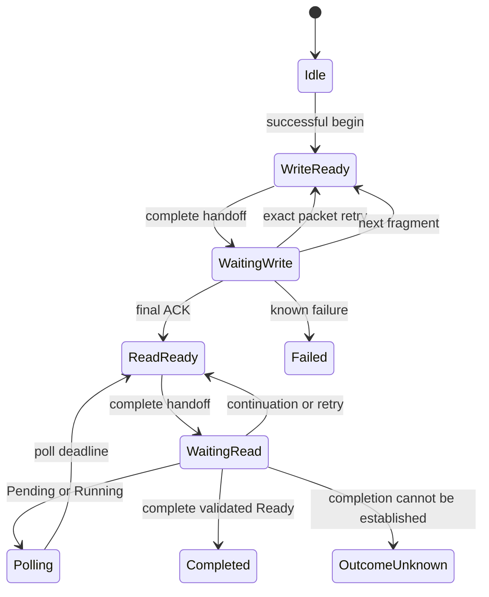

# Typed RpcClient v1

[Документація](README.md) · [Mailbox wire](RpcMailboxV1.md) ·
[Серверні сеанси](RpcSessionsV1.md) · [Клієнтський приклад](../examples/rpc_client/README.md)

## Призначення та межа модулів

`resource::telemetry::v3::RpcClient` виконує один вихідний RPC за раз.
Він кодує typed Request, формує Resource WRITE/READ, перевіряє ACK,
опитує стан, збирає відповідь і декодує її через наявний Telemetry Codec.
Application передає повні пакети, час та підтвердження передачі.

Це окреме доповнення до наявного `RpcMailbox`. Request залишається 24-байтовим
TRPC header + canonical payload, response — 32-байтовим TRPS header + payload.
Resource v1, endpoint ABI, descriptor v3 і серверна машина станів не змінюються.
Потоків, сокетів, HAL, RTOS, динамічних черг чи heap у клієнті немає.

Baseline реалізації цього розширення —
`f615775bf3dd4c7c4e12ac047e60b111e52ce0dd`. Початковий аудит перевірив
`Client.hpp`, `RpcWire.hpp`, `RpcMailbox`, Codec/Workspace і статуси до
вибору public API. Узгоджений поділ: typed wrappers у header, одна
нетемплейтна packet/state machine у `.cpp`, окремий header-only session pool.

## Підключення

```cpp
#include <telemetry/client/rpc/RpcClient.hpp>
namespace rpc = resource::telemetry::v3;
```

Клієнт залежить від Codec і типів статусів, але не потребує локального Model,
Model Adapter чи RpcMailbox. Для qmake використовуйте окремий client manifest
і client flag; точний runnable setup наведено в [прикладі](../examples/rpc_client/README.md).
Не додавайте `RpcMailbox.cpp` до client-only firmware.

```qmake
CONFIG += telemetry_client_rpc
include(path/to/lib/telemetry/client/client.pri)
```

`client.pri` підключає header-only Codec та компілює лише
`lib/telemetry/client/rpc/RpcClient.cpp`. Generic `Protocol.cpp` потрібний
окремо для серверного `resource::protocol::process()`.
Symbols `resource::telemetry::v3` збережені; новий namespace
`telemetry::client::rpc` надає aliases. Старий include path доступний лише
через явно доданий `lib/telemetry/client/compat` include root.

`beginEncoded(operation, id, payload, responseBytes)` копіює вже перевірений
canonical payload до request buffer. Цей raw entry point довіряє admission
і type mapping; результат доступний через `resultBytes()`, а
`decodeResult<T>()` відмовляє через відсутність typed identity. Typed `begin*`
методи зберігають чинну поведінку. Bounded FIFO над engine надає
[DeviceClient](AsyncClient.md).

## Власність і пам'ять

Application надає три стабільні, непересічні byte buffers, backing storage яких
живе довше за сам `RpcClient`. Таблиця нижче описує збереження їхнього вмісту,
а не момент, коли можна звільнити backing memory:

| Buffer | Вміст | Незмінність bytes |
| --- | --- | --- |
| request storage | Увесь TRPC header і закодований Request | До завершення, reset або втрати сеансу |
| result storage | Payload відповіді без 32-byte TRPS header | До наступного успішного begin/reset |
| packet storage | Один повний вихідний Resource request | До обробки відповідного reply/reset |

Сам `RpcClient` не копіюється й не переміщується. References/spans на його
стан і bytes позичені. Буфери не використовують для іншої роботи, поки client
ними володіє за цим контрактом. RX packet може бути короткоживучим: потрібні
result bytes копіюються під час `onReply()`, pointer на RX не зберігається.
RX reply також не перекриває жодного з трьох client buffers. Для цього API
вихідний packet і вхідний reply мають окреме storage навіть тоді, коли generic
Resource operation допускає in-place використання буфера.

Request capacity — щонайменше 24 і не більше `UINT32_MAX` bytes, packet —
щонайменше 40 bytes, result — не більше `UINT32_MAX - 32`. Хибна композиція
буферів або options є порушенням constructor contract і викликає abort;
це не відкладений status від `begin*()`.

Request кодується один раз у `begin*()`. Зміна прикладного Request після цього
не змінює повторені пакети. Великі Request/Response не копіюються в приховані
локальні об'єкти. Повний Request може перевищувати 65 535 байтів; кожен
Resource WRITE payload обмежено 65 535 і місткістю packet buffer.

Перший WRITE містить щонайменше цілий 24-byte RPC header. Перша відповідь READ
потребує щонайменше 12-byte Resource header + 32-byte RPC snapshot. Місткість
server-side reply packet забезпечує application; це не result storage client-а.

## Типізовані endpoint bindings

```cpp
struct Add { std::uint32_t value; };
struct Report { std::uint32_t total; };

constexpr rpc::ServiceEndpoint<Add, Report> add{0, rpc::trustedRpcMapping};
constexpr rpc::CommandEndpoint<> stop{0, rpc::trustedRpcMapping};
constexpr rpc::FieldEndpoint<float> voltage{0, rpc::trustedRpcMapping};
```

Packed endpoint ID — `u32`. Однаковий числовий ID у різних сімействах має
різний зміст: operation визначає Field/Command/Service. `trustedRpcMapping`
є явним твердженням application про типи цього remote endpoint. Це не
автоматичний parser descriptor і не перевірка особи чи прав peer.

Потрібні два окремі докази:

1. Client запам'ятовує exact локальний Response type. Інший `T` у decode
   відхиляється навіть для однакового `wireSize`.
2. Application встановлює відповідність remote ID і типів через спільний
   контракт та одноразове узгодження descriptor fingerprint у сеансі.

`float` та `u32`, а також два різні struct однакової довжини не є взаємозамінними.
RTTI не використовується. Runtime descriptor validation може бути додана
application перед створенням trusted binding; нового descriptor parser у v1
немає. Fingerprint, TypeId, generation чи correlation ID до RPC packets не додаються.

## Public API

| Метод | Призначення |
| --- | --- |
| `RpcClient(index, request, result, packet, options)` | Позичити storage і зафіксувати mailbox FileIndex |
| `startSession(generation, lastTransactionId=0)` | Почати допущений сеанс після schema agreement |
| `beginReadField(FieldEndpoint<T>)` | Запросити native `T` |
| `beginWriteField(FieldEndpoint<T>, const T&)` | Закодувати Field value |
| `beginCommand(CommandEndpoint<Q>, const Q&)` | Command з одним Request |
| `beginCommand(CommandEndpoint<void>)` | Command без Request |
| `beginService(ServiceEndpoint<Q,R>, const Q&)` | Service Request/Response |
| `beginService(ServiceEndpoint<void,R>)` | Service без Request |
| `process(nowMs)` | Обслуговувати deadlines і poll interval |
| `nextPacket()` | Позичити наступний Resource packet і local pairing metadata |
| `onSendAccepted(generation, requestId)` | Підтвердити повну передачу packet транспорту |
| `onReply(bytes, generation, requestId)` | Перевірити відповідний повний reply |
| `loseSession(generation)` | Зафіксувати втрату поточного сеансу |
| `reset()` | Явно завершити локальну роботу; не скидає remote mailbox |
| `state()/status()/diagnostic()` | Прочитати lifecycle та незалежні статуси |
| `active()/completed()` | Перевірити локальний етап |
| `resultBytes()` | Позичити bytes валідного завершеного payload |
| `decodeResult(T&)` | Декодувати в уже живий caller-owned object |
| `decodeResult(Workspace::Lease<T>&, T*&)` | Конструювати об'єкт у caller-owned Workspace |

`void` Request/Response не має об'єкта і займає нуль wire bytes. Field value
не може бути void. Підтримувані типи визначає той самий
[Codec](user/CodecAndWorkspace.md), що й локальні encoded endpoints.
Command Request і Service Request/Response — struct або void, відповідно до
чинних native factories. Field допускає scalar, enum, array та struct.
Невідомий representable enum code зберігається згідно з чинним codec contract;
неправильна bool representation відхиляється.

Невдалий локальний `begin*()` повертає причину і не відпускає попередній
завершений result/diagnostic. Успішний begin починає новий transaction.
`lastTransactionId` призначений для явно відомого high-water mark, а не для
прихованого replay після reconnect.

## Transport event loop

Application викликає `process(nowMs)` перед `begin*()`, перед подіями й
періодично без пакетів. Загальний deadline починається у begin від останнього
переданого tick, ACK deadline — після повного transport handoff.
Час — modulo-u32 milliseconds; deadlines мають bounded interval.

1. Взяти `nextPacket()`. `bytes` — позичений незмінний повний Resource request.
2. Спробувати передати весь packet своїм transport/framing.
3. Якщо transport прийняв повний packet, повідомити `onSendAccepted()` з
   generation/requestId цього packet. Лише тоді починається ACK timeout.
4. Доставити відповідний повний reply через `onReply()` із тими самими local
   metadata. Перед цим відкинути старий connection generation.
5. Після переходу `completed()` прочитати статуси й декодувати response.

Передача у транспорт не доводить приймання сервером. При backpressure packet
залишається готовим; не повідомляйте accepted для частково записаного TCP
stream або невзятої DMA-черги. Якщо транспорт позичає outgoing bytes,
application має завершити використання до будь-якого їх повторного використання
клієнтом; за потреби транспорт копіює packet у власну bounded TX-чергу.

Resource reply не містить request ID. Generation/requestId у цьому API —
локальна зовнішня metadata, яку application прив'язує до обміну, а не нові
поля wire. На одному логічному каналі без outer correlation дозволено лише
один незавершений Resource exchange. Кілька RpcClient на одному TCP потребують
serialization або зовнішнього demultiplexing. Повтор може створити кілька
відповідей: application зберігає правильне pairing і відкидає зайві/старі replies.

## Стани, повтори та результати



WRITE retry зберігає bytes, transaction ID, cursor, final і межі фрагмента.
ACK перевіряється на точні `consumed`, `next`, `complete`, не лише status.
READ починається з cursor zero, незалежно від WRITE cursor. Pending/Running
з EOF означають завершення status snapshot; для нового poll знову cursor zero.
Ready payload збирається за continuation cursor і перевіряється до decode.

Transaction ID, local generation і request ticket — `u32`, без wrap.
Вичерпання повертає явну відмову; мовчазного повторного використання ID немає.
Транспорт має виключити старі події перед відкриттям нового сеансу.
Успішний `startSession()` із новою, строго більшою generation починає нову
послідовність request tickets; звичайні `reset()` та `begin*()` її не скидають.
Generation, що вже дорівнює `UINT32_MAX`, не можна повторно використати в цьому
об'єкті. Новий connection context не може приймати події старого сеансу.

| `RpcClientOptions` | Default | Значення |
| --- | --- | --- |
| `ackTimeoutMs` | 1000 | Очікування reply після повного handoff |
| `transactionTimeoutMs` | 30000 | Загальна тривалість RPC, включно з polling |
| `pollIntervalMs` | 10 | Інтервал нового status READ |
| `maxRetries` | 3 | Кількість повторів одного Resource exchange |

Часові інтервали обмежені modulo-u32 правилами: менші за `2^31` ms.
ACK і transaction timeout ненульові; poll interval 0 дозволений.
`maxRetries` не може дорівнювати `UINT32_MAX`.
Application постачає монотонний tick із дозволеним природним wrap u32.
Перший Ready reply може містити лише RPC header: cursor переходить на 32,
а payload продовжується наступним READ. Порожній continuation без просування
cursor відхиляється.

Після можливого приймання final WRITE timeout/disconnect не доводить, чи
callback виконався. `OutcomeUnknown` зберігає причину; це не application
`Failed`. У новому сеансі автоматичного replay немає. До final, який міг
дійти до сервера, можливі відомі локальні відмови без прикладного ефекту.

## Шари статусів

| Шар | Де читати | Що означає |
| --- | --- | --- |
| Client lifecycle | `status`, `cause` | Busy, timeout, malformed reply, session loss, uncertain outcome |
| Resource/provider | `resourceStatus` | Доступ до файла, cursor і capacity |
| Encoded dispatch | `dispatch` | Пошук endpoint, payload, Workspace, unavailable binding |
| Application | `operation` + `endpointStatus` | WriteResult, CommandResult або ServiceStatus |
| Decode | `RpcClientDecodeResult`, `codec` | Exact native type і canonical representation |

Client `Completed` означає валідний завершений RPC record, включно з
прикладною відмовою. Нульові status bytes до Ready не є успішним результатом.
`CommandResult::Accepted` означає постановку роботи application у чергу;
її фізичне завершення цим протоколом не встановлюється.

## Великі результати

`decodeResult(T&)` перевіряє весь payload до першого присвоювання. При
malformed representation output залишається незмінним. Output/Workspace
не перекривають client storage. Lease дотримується наявного LIFO lifetime
контракту; client та lease не володіють backing memory.
Pointer variable, переданий як `T*&`, також не розміщують у client storage;
він має бути окремим від Workspace, де конструюється `T`.

`reset()` під час активного RPC завершує його як Cancelled або OutcomeUnknown
із cause Cancelled. Наступний явний reset завершеного стану очищує evidence;
успішний begin також може замінити попередній result/diagnostic. Невдалий begin
цього не робить. Decode-помилка залишає Completed і payload доступними для
повторного decode у правильний output.

Зручний owning `result<T>()` у початковий мінімальний API не вводиться:
`decodeResult` однаково працює для scalar і великих DTO без неявних copies.
Використання показано в [скомпільованому прикладі](../examples/rpc_client/main.cpp).

## Qualification

Підтримувані перевірки й фактичні counts наведено в
[client suite](../tests/structured/rpc_client/README.md). Старий
[Mailbox suite](../tests/structured/rpc/README.md) залишається окремим regression
gate. Host execution, ASan/UBSan та ARM compile/link/stack — різні докази.
Новий client/session зріз не додає hardware measurements і не змінює старі receipts.
