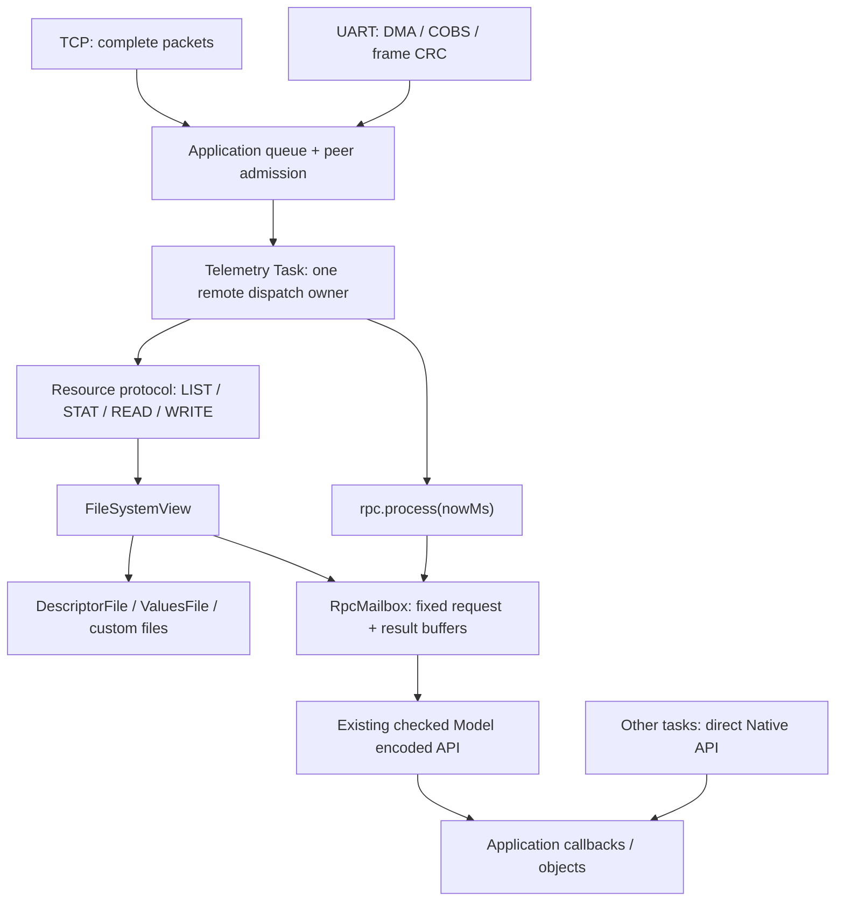
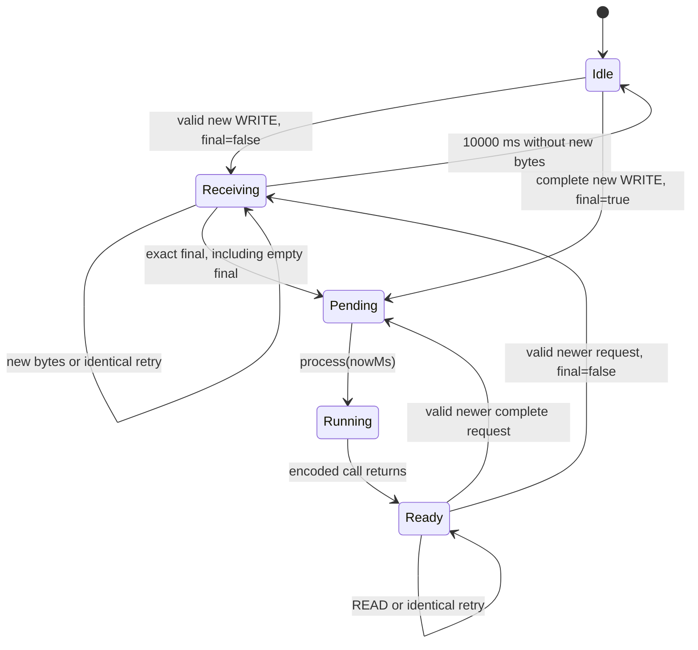

# RpcMailbox: wire-контракт v1.0 і стани

**Статус: реалізований optional provider, RPC wire v1.0.**
[`RpcMailbox`](../lib/integration/telemetry/v3/RpcMailbox.hpp) підключається явно;
він не змінює чинні Telemetry v3.0, Resource v1, DescriptorFile, ValuesFile
або optional Bind/Exchange example. Нормативні слова «має», «дозволено» та
«відхиляємо» визначають контракт реалізації. Повний runnable host-приклад —
[`examples/rpc_mailbox`](../examples/rpc_mailbox/README.md). Наявність коду
не є вимірюванням UART/TCP чи виконанням на MCU.

Для qmake source provider-а обирається незалежним
`CONFIG += resource_telemetry_rpc` перед `resource.pri`; `telemetry.pri`
підключається явно. Прапорець `resource_telemetry` самостійно залишає
Descriptor/Values-only збірку без компіляції RPC.

[Індекс документації](README.md) · [Архітектура](Architecture.md) ·
[Resource protocol](../lib/resource/protocol/README.md) ·
[Encoded API](../lib/telemetry/model/Adapter.hpp)

## 1. Призначення і межі

Один необов'язковий read/write provider публікується під рекомендованим
плоским path `/telemetry/rpc.bin`. Path задає application у своєму масиві
файлів; file index залишається позиційним `u32`, як для решти Resource.



Telemetry Task, транспортні черги, admission, clocks і синхронізація owner
даних належать application. Provider не створює tasks, mutex, atomic fields,
динамічних черг або heap allocations. Native API залишається прямим.
Callbacks і всі binding objects мають стабільні адреси; rebind/reset target
одночасно з викликом не допускається без зовнішньої синхронізації.

Borrowed `const T&` дозволений за чинним
[lifetime contract](BorrowedNativeValues.md#lifetime-and-synchronization).
Application захищає referent на весь час encoding. ValuesFile і надалі
читає живі Fields; спільного snapshot усіх значень RPC не додає.

## 2. Сеанс і власність

Один mailbox обслуговує **один допущений клієнтський сеанс**. TCP/UART
не передають peer identity через provider interface, тому application
перевіряє власника до `resource::protocol::process()`. Одна Telemetry Task
упорядковує C++ виклики, але не замінює цю перевірку.

Перед першим RPC application одноразово узгоджує descriptor fingerprint
із клієнтом. Можна використати домовленість власного протоколу; залежності
від [example Bind](../examples/structured_protocol/README.md) немає.
Fingerprint, session ID і TypeId у кожний RPC-запит не додаються.

У межах допущеного сеансу `transactionId` — ненульовий `u32`, який строго
зростає. Перехід `UINT32_MAX → 1` у тому самому сеансі заборонений.
До вичерпання ID application завершує сеанс, видаляє старі queued frames,
скидає mailbox і починає нове узгодження. Пропуск номерів дозволений.

Mailbox зберігає `highWaterId`: найбільший прийнятий ID цього сеансу.
Timeout не скидає його. Поточний збережений request — окремий факт:
повтор його ID спочатку перевіряється як можливий duplicate, а не одразу
відхиляється правилом строго зростаючих ID.

Disconnect, reboot або заміна Model завершують сеанс. Application припиняє
admission старого peer, видаляє його пакети й серіалізовано викликає
`resetSession()`. Він скидає стан, high-water mark і результат.
Receiving/Pending можна скасувати без callback. Running не переривається:
спочатку закінчується активний виклик, потім виконується reset. Новий peer
не успадковує старі binding, bytes або ID. Cursor не відрізняє два сеанси;
старі кадри має виключити транспортна інтеграція.

Практичний спосіб — зовнішній `connectionGeneration` у metadata кожного
queued packet поряд із peer identity. Ingress прив'язує generation до
конкретного з'єднання під час приймання кадру; owner перевіряє його **до**
`resource::protocol::process()`. Після disconnect нове з'єднання отримує
нове generation. Лише очистити чергу недостатньо: старий ingress callback
може поставити свій кадр пізніше. Не призначайте поточне generation старому
кадру під час dequeue. Generation не є полем Resource або RPC wire і не
змінює cursor; правило його неповторення, admission і черги належать
application. Приклад показує відмову старому generation навіть для того
самого peer identity та повторно використаного transactionId.

## 3. Формат запиту: 24 bytes

RPC bytes передаються як `data[]` звичайних Resource WRITE. Це окремий
wire v1.0, незалежний від версії Telemetry descriptor v3.0. Усі integers
explicit little-endian, без C++ padding і typed unaligned loads.
Кожний Resource `data[]` має не більше 65535 bytes; повний RPC request
може бути більшим і передаватися багатьма WRITE.

| Offset | Bytes | Поле | Правило |
| --- | --- | --- | --- |
| 0 | 4 | magic | ASCII `TRPC` |
| 4 | 2 | major | `1` |
| 6 | 2 | minor | `0` |
| 8 | 4 | transactionId | `1..UINT32_MAX` |
| 12 | 4 | endpointId | packed `u32`: group у high 16 bits, entry у low 16 bits |
| 16 | 4 | payloadBytes | Кількість bytes після цього заголовка |
| 20 | 1 | operation | Таблиця нижче |
| 21 | 1 | flags | `0` |
| 22 | 2 | reserved | `0` |
| 24 | payloadBytes | payload | Чинний canonical Telemetry codec |

`requestBytes = 24 + payloadBytes` рахується з перевіркою переповнення,
має вміщатися в `u32` та request buffer. Перший WRITE із cursor zero
містить **цілий 24-byte заголовок**, а також довільний початковий payload
prefix. Розбиття заголовка між WRITE у v1 не підтримується.

| operation | Значення | Payload | Encoded виклик | Максимальний result payload |
| --- | --- | --- | --- | --- |
| FieldWrite | 1 | Значення Field | `writeFieldEncoded` | 0 |
| Command | 2 | Void або один Request | `executeCommandEncoded` | 0 |
| Service | 3 | Void або один Request | `callServiceEncoded` | Response wire size або 0 для Void |
| FieldRead | 4 | Порожній; `payloadBytes == 0` | `readFieldEncoded` | Field wire size |

Перші три коди мають знайомий порядок з Exchange, але це **інший wire
contract**: Exchange не отримує mailbox deduplication і зберігає свої правила
request IDs. Фактичні payload bytes і endpoint statuses не перевизначаються.
Request struct не замінюється набором scalar arguments.

Unknown magic/version/operation, ненульові flags/reserved, ID zero, некоректна
довжина або непорожній FieldRead payload відхиляються Resource `InvalidData`.
Спроба оголосити request, більший за надане сховище, повертає
`BufferTooSmall`; збільшення лише розміру одного transport fragment цього
не виправляє. Фрагмент не приймається і старий result не видаляється.

## 4. Cursors і підтвердження WRITE

Resource cursor зберігає тип `u64` і залишається opaque для generic core.
Для цього provider-а v1 визначено:

```text
cursor(tx, offset) = (u64(tx) << 32) | u32(offset)
```

Cursor zero запускає новий transfer. Для WRITE `offset` рахується від
початку **всього RPC request, включно з 24-byte заголовком**. Header є тільки
в першому фрагменті; продовження передає наступні request bytes.

Mailbox має `receivedBytes` — довжину вже збереженого contiguous prefix.
Новий фрагмент починається рівно з `receivedBytes`. Перестрибування вперед,
змішування ID та часткове перекриття з одночасним додаванням нових bytes
не допускаються. Кожен фрагмент приймається повністю або не приймається.
Сума offset та input length перевіряється до звуження/копіювання;
переповнення або вихід за requestBytes повертає `InvalidData`.

Для будь-якого успішного WRITE, зокрема duplicate:

```text
consumed = input.size()
next     = cursor(tx, fragmentOffset + input.size())
complete = accepted final=true
```

`next` для duplicate позначає кінець **саме повтореного фрагмента**, а не
поточний загальний `receivedBytes`. Старий ACK може бути відтворений без
зберігання історії всіх меж пакетів. `complete=true` означає, що request
запечатаний для виконання; це не підтвердження завершення callback.
Воно також не гарантує майбутнього виконання: disconnect/resetSession у
Pending може відкинути request до dispatch. Відсутність результату після
розриву не дає клієнту визначити, чи callback уже виконався. Повтор
неідемпотентної операції в новому сеансі може повторити її прикладний ефект;
такий outcome треба з'ясовувати засобами application, а не припускати успіх
або відсутність виконання за ACK чи timeout.

Усі помилки provider-а зберігають вхідний cursor, повертають `consumed=0`,
`complete=false` і не змінюють стан, buffers, результат або high-water mark.
Resource wrapper не гарантує повернення ACK, якщо transport його втратив.

### Новий request і скасування Receiving

Перший WRITE із cursor zero та ID `> highWaterId` дозволений у Idle,
Receiving і Ready. У Receiving він скасовує попереднє приймання; у Ready
звільняє попередній result. **Спочатку** перевіряються весь перший фрагмент,
header, capacity і final; лише потім замінюються bytes і підвищується ID.
Невдалий новий WRITE не руйнує попередній request/result.

У Pending/Running новий ID повертає Resource `InvalidData`, без приймання.
Клієнт опитує стан і може повторити новий request після Ready. ID відхиленої
спроби не витрачається. ID нижче high-water mark, а також ID скасованого чи
простроченого request, повертає `CursorExpired`.

Cursor zero з **поточним** ID перевіряється як duplicate першого фрагмента.
Не можна відхилити його лише тому, що цей ID уже приймався.
Ненульовий WRITE cursor із невідомим майбутнім ID повертає `InvalidCursor`;
новий request починається тільки з cursor zero. Для ID <= highWaterId,
який уже не має збереженого request, повертається `CursorExpired`.
Ненульовий cursor із нульовими high 32 bits повертає `InvalidCursor`.

### Duplicate і final

Duplicate range повністю лежить у збереженому prefix, а його bytes точно
збігаються. Повний request buffer зберігається в Pending/Running/Ready,
щоб ці порівняння залишалися можливими після виконання.

| Випадок | Рішення |
| --- | --- |
| Прийнятий range, ті самі bytes, `final=false`, непорожній input | ACK з `complete=false`; стан не змінюється |
| Будь-які bytes у прийнятому range відрізняються | `InvalidData`; збережений request/result не змінюється |
| Range починається після receivedBytes або перетинає його межу | `InvalidCursor`; нові bytes не додаються |
| `final=true`, але кінець range не дорівнює requestBytes | `InvalidData`; **цей фрагмент не приймається** |
| Новий range завершує request точно, `final=true` | Копіювання, seal, Pending, ACK `complete=true` |
| Увесь request прийнятий із `final=false` | Лишається Receiving до final або timeout |
| Порожній input, cursor на requestBytes, `final=true`, весь request уже прийнятий | Seal у Receiving або duplicate ACK у Pending/Running/Ready; `consumed=0`, `complete=true` |
| Повністю збережений range до кінця request, `final=true` | Seal у Receiving або duplicate ACK у Pending/Running/Ready |
| Порожній input з `final=false` | `InvalidData`: незавершений WRITE без прогресу не підтримується |

`final` є інструкцією seal, а не частиною request bytes. Зміна `false → true`
дозволена лише для range, що закінчується рівно на requestBytes та проходить
решту перевірок. Раніший непорожній `final=false` duplicate після seal дає
`complete=false`, але не повертає mailbox у Receiving. Прийнятий final
повторно підтверджується у Pending, Running і Ready без повторного виконання.

## 5. Формат стану і результату: 32-byte header

Resource READ повертає RPC record із заголовком нижче. Заголовок не
передається частинами; READ із cursor zero потребує output щонайменше
32 bytes. Інакше повертається `BufferTooSmall` без зміни стану.
Це provider output: з 12-byte зовнішнім Resource header мінімальний
transport response buffer для такого READ становить 44 bytes.

| Offset | Bytes | Поле | Правило |
| --- | --- | --- | --- |
| 0 | 4 | magic | ASCII `TRPS` |
| 4 | 2 | major | `1` |
| 6 | 2 | minor | `0` |
| 8 | 4 | transactionId | Поточний ID; у Idle — highWaterId, початково 0 |
| 12 | 4 | endpointId | Поточний packed ID; у Idle 0 |
| 16 | 4 | payloadBytes | Фактичний result size у Ready; інакше 0 |
| 20 | 1 | operation | Поточна operation; у Idle 0 |
| 21 | 1 | state | Значення з таблиці станів |
| 22 | 1 | dispatchStatus | Зміст має тільки в Ready; до Ready 0 |
| 23 | 1 | endpointStatus | Зміст має тільки в Ready з dispatch Ok; інакше 0 |
| 24 | 4 | receivedBytes | Прийняті request bytes із заголовком; у Idle 0 |
| 28 | 4 | requestBytes | Повна очікувана довжина request; у Idle 0 |
| 32 | payloadBytes | payload | Canonical Field value або Service Response |

Idle з ненульовим ID означає збережений high-water mark після timeout,
а не готовий result. Стан перевіряється **до** status bytes. До Ready нуль
у dispatchStatus не означає успішний callback. Усі bytes визначені;
невикористані поля нульові, старі buffer bytes не передаються.
«Поточний tx» у правилах cursors означає збережений request у
Receiving/Pending/Running/Ready. У Idle highWaterId є лише tombstone:
наприклад, cursor(126, 32) після timeout tx=126 повертає `CursorExpired`.

### READ і size

`size()`/STAT повідомляє поточний логічний розмір read record:

```text
Idle / Receiving / Pending / Running: 32
Ready:                               32 + payloadBytes
```

Це поточний size, не request capacity. Він може змінитися між окремими
викликами. READ та opaque cursor, а не попередній STAT, визначають transfer.

| READ | Результат |
| --- | --- |
| cursor zero, не Ready | Цілий 32-byte status snapshot, `next=0`, `eof=true` |
| cursor zero, Ready | Header і стільки result payload, скільки вміщується; `next=cursor(tx, 32 + emittedPayload)`, EOF лише коли весь record передано |
| cursor(tx, offset), Ready, `32 <= offset <= size()` | Immutable result continuation; bytes із offset, next після них; offset==size дає порожній EOF |
| Непорожній залишок result і порожній output | `BufferTooSmall`, cursor незмінний |
| Cursor поточного tx до Ready або offset<32 / offset>size | `InvalidCursor` |
| Cursor попереднього, скасованого чи простроченого tx | `CursorExpired` |
| Cursor невідомого майбутнього tx | `InvalidCursor` |

`eof=true` для Pending/Running завершує **читання status snapshot**, а не RPC.
Для наступного опитування клієнт знову використовує cursor zero. Ready record
і його bytes незмінні до приймання нового request або resetSession. Повторні
READ не споживають result і не викликають callback. Для Ready з порожнім
payload перший READ повертає 32 bytes та EOF.

WRITE і READ cursors мають ту саму упаковку, але offset відноситься до
різних streams: request та response. Клієнт не переносить next із WRITE
в READ; читання результату починається з zero.
Будь-яка READ помилка повертає `written=0`, незмінний вхідний cursor та
`eof=false`; output, стан і збережені bytes залишаються незмінними.
Ненульовий READ cursor із нульовими high 32 bits — `InvalidCursor`.

### Статуси encoded виклику

`dispatchStatus` передає чинний `telemetry::DispatchStatus`:

| Code | Назва |
| --- | --- |
| 0 | Ok |
| 4 | NotFound |
| 5 | InvalidPayload |
| 6 | BufferTooSmall |
| 7 | WorkspaceTooSmall |
| 8 | InternalError |
| 9 | Unavailable |

Коли dispatch не Ok, endpointStatus і payloadBytes дорівнюють 0. Коли він
Ok, endpointStatus визначається operation:

| Operation | endpointStatus codes |
| --- | --- |
| FieldRead | 0, без окремого application status |
| FieldWrite | Applied=0, NotFound=1, ReadOnly=2, InvalidValue=3, Busy=4, Unavailable=5 |
| Command | Executed=0, Accepted=1, NotFound=2, Unavailable=3, ArgumentCountMismatch=4, InvalidValue=5, Busy=6, Failed=7 |
| Service | Ok=0, InvalidArgument=1, Unavailable=2, Busy=3, Failed=4 |

Payload є тільки для успішного FieldRead або Service з endpoint Ok.
Command/FieldWrite й усі відмови мають payloadBytes=0. Lookup NotFound та
application NotFound залишаються різними результатами. Application Busy —
готова відмова endpoint у Ready, не новий Resource status.

**Ready означає повернення encoded-виклику.** CommandResult::Accepted
означає, що application поставив роботу у свою чергу. Mailbox уже Ready,
але фізичне виконання цієї роботи ним не відстежується.

## 6. Стани і переходи

| state | Code | Зміст |
| --- | --- | --- |
| Idle | 0 | Немає request; highWaterId може бути ненульовим |
| Receiving | 1 | Приймається contiguous request; callback ще не дозволено |
| Pending | 2 | Точна довжина прийнята і final підтверджений |
| Running | 3 | Один синхронний encoded-виклик виконується |
| Ready | 4 | Результат або відмова encoded-виклику збережені |



| Поточний стан | Подія | Наступний стан / дія |
| --- | --- | --- |
| Idle/Receiving/Ready | Прийнятий новіший перший WRITE | Receiving або Pending залежно від final; новий highWaterId |
| Receiving | Новий contiguous фрагмент без final | Receiving; receivedBytes збільшено |
| Receiving | Коректний exact final | Pending; останній ACK не чекає callback |
| Receiving | Некоректний або ранній final | Стан і bytes не змінені; error ACK |
| Receiving | Timeout | Idle; highWaterId збережено, request bytes більше недоступні |
| Pending | process | Running; рівно один encoded dispatch attempt |
| Running | Encoded виклик повернувся | Ready навіть для dispatch/application відмови |
| Pending/Running/Ready | Коректний duplicate | Стан/result незмінні; ACK, callback не повторюється |
| Pending/Running | Новіший перший WRITE | Відмова; поточний request не скасовується |
| Будь-який | READ | Стан незмінний; status/result або cursor error |
| Будь-який | Некоректний WRITE | Стан, bytes і highWaterId незмінні |
| Не Running | resetSession | Idle, highWaterId=0, request/result видалені |
| Running | resetSession | No-op; owner викликає reset після повернення активного callback |

Окремі explicit стани Failed/Cancelled не вводяться. Невдалий encoded call
завершується Ready з його status. Timeout скасовує тільки Receiving.
Pending/Ready не мають прихованого timer, який повторно запускає callback
або мовчки видаляє непрочитаний result.

## 7. Час, ACK і виконання

Provider interface (`resource::telemetry::v3`, header
`<integration/telemetry/v3/RpcMailbox.hpp>`):

```cpp
RpcMailbox(const telemetry::ModelView& model, telemetry::Workspace& workspace,
           resource::Output requestStorage, resource::Output resultStorage) noexcept;
RpcState state() const noexcept;
resource::FileSize size() const noexcept;
resource::ReadResult read(resource::Cursor, resource::Output) const noexcept;
resource::WriteResult write(resource::Cursor, resource::Input, bool final) noexcept;
void process(std::uint32_t nowMs) noexcept;
void resetSession() noexcept;
```

`RpcState` має значення Idle/Receiving/Pending/Running/Ready з таблиці вище.
ModelView та Workspace передаються як іменовані stable lvalues; temporary
або приховане перетворення не створює їхнього довгого lifetime. Mailbox
позичає ці об'єкти, tables, binding targets і buffers. Зберігайте їх на
стабільних адресах протягом усіх operations.

`process(nowMs)` отримує application clock у milliseconds. Тип clock — u32
із природним modulo wrap. Application передає послідовний час без довільних
стрибків назад і викликає process періодично; проміжок між викликами має бути
меншим за 2^31 ms. Timeout перевіряється unsigned різницею:

```text
u32(nowMs - lastProgressMs) >= 10000
```

`write()` не звертається до HAL або системного clock. Перед кожним packet
owner оновлює час через process; прийняті **нові** bytes використовують цей
останній час. Duplicate, READ, відхилений WRITE і порожній final не подовжують
Receiving timer. Якщо між оновленням часу й WRITE була довга затримка,
зокрема виконання callback, owner спочатку передає свіжий nowMs.

Owner спочатку формує та передає transport-у ACK останнього WRITE, а вже
на наступному кроці викликає process для Pending. Provider `write()` ніколи
не викликає Field/Command/Service. ACK не вимагає чекати фактичного отримання
клієнтом; втрата ACK закривається повтором WRITE.

process спочатку перевіряє timeout Receiving; для Pending переходить у
Running **до** encoded dispatch, публікує Ready після повернення і не виконує
більше одного request за виклик. Немає автоматичного повтору при будь-якій
відмові, навіть коли попередній callback міг мати прикладний ефект.

Синхронний callback займає owner до повернення. Звичайний однопотоковий
loop не може водночас відповідати на мережевий poll Running. Формат такого
status визначений, але він не обіцяє паралельної обробки або обмеженого часу
відповіді. Серіалізований вкладений read чи duplicate write у Running може
лише читати зафіксований стан/request; нове виконання, recursive process,
`resetSession()` у Running є no-op і не відкладає reset автоматично; owner
повторює його після повернення callback. Знищення mailbox під активним
callback заборонене. Звернення з іншої task потребує зовнішньої
синхронізації; provider її не додає.

## 8. Buffers і preflight

Application надає fixed-capacity request buffer, result-payload buffer та
Workspace. Provider позичає їх на весь свій lifetime. У request buffer
вміщується заголовок 24 bytes і весь native request. Result buffer містить
лише payload; 32-byte response header формується з mailbox metadata.

Request buffer має capacity щонайменше 24 і не більше UINT32_MAX bytes.
Result payload capacity не перевищує UINT32_MAX-32, щоб логічний read size
також лишався u32. Порушення цих capacity bounds є construction error:
constexpr construction не компілюється, runtime construction завершує
виконання. Обидва buffers, Workspace і mailbox metadata не
перекриваються. Request bytes зберігаються до приймання наступного request
або reset; використовувати їх як result storage не можна.
Timeout/reset відкидають логічну доступність bytes, а не очищають великі
buffers нулями. Старі bytes не входять у жодний доступний status/result.

Input/output spans Resource дійсні лише під час read/write. WRITE копіює
байти у request buffer до повернення; посилання на DMA/RX packet не
зберігаються. Повний output span READ має бути disjoint від збережених
request/result, metadata, Workspace і borrowed application objects.
Application передає коректні spans та забезпечує ці lifetime/alias умови.
Transport request/reply можуть перекриватися між собою за чинним Resource
contract, але їхнє сховище не перекриває request/result buffers, Workspace
або metadata mailbox. Це також виключає alias input нового WRITE з місцем,
у яке provider копіює прийняті bytes.

У process existing checked Encoded API виконує lookup, capability/length,
codec і scratch перевірки. Конкретний endpoint має отримати повну можливу
response capacity **до** callback, навіть якщо application міг би повернути
відмову без payload. Запит не виконується з обрізаним result buffer.

Mailbox не викликає внутрішні raw thunks і не створює іншу систему codec
validation. Чинний порядок encoded перевірок зберігається: наприклад,
read-only FieldWrite може повернути endpoint ReadOnly до перевірки payload.
Seal/Pending підтверджує framing і повноту bytes, а не валідність значення
bool, існування endpoint чи успіх application. Ці відмови доступні у Ready.

Invalid bool representation відхиляється за чинним codec contract; невідомий,
але representable enum code дозволений. Нових semantic limits немає.
Preflight відмови не викликають application callback. Водночас **не кожен**
не-Ok dispatch доводить відсутність ефектів: borrowed-output alias або
некоректний callback status можуть бути виявлені вже після виклику.
Будь-який такий результат зберігається без повторного dispatch.

## 9. Приклади і точні bytes

### Три фрагменти й втрачений ACK

Нехай Command tx=125, endpointId=0x00010002 має Request wire size 96.
RPC request разом із заголовком займає 120 bytes.

```text
WRITE cursor=0,                  data[0:40],   final=false
  -> next=0x0000007D00000028, consumed=40, complete=false
WRITE cursor=0x0000007D00000028, data[40:80],  final=false
  -> next=0x0000007D00000050, consumed=40, complete=false
WRITE cursor=0x0000007D00000050, data[80:120], final=true
  -> Pending(125), next=0x0000007D00000078, consumed=40, complete=true
     ACK може бути втрачено
process(nowMs)
  -> Running -> executeCommandEncoded -> Ready
RETRY cursor=0x0000007D00000050, ті самі data[80:120], final=true
  -> той самий ACK; без другого callback
READ cursor=0
  -> 32-byte Ready header, tx=125, payloadBytes=0, eof=true
WRITE cursor=0, новий коректний header tx=126, ...
  -> попередній result відпущено лише після приймання нового фрагмента
```

24-byte header цього request:

```text
54 52 50 43  01 00 00 00  7D 00 00 00  02 00 01 00
60 00 00 00  02 00 00 00
```

32-byte Ready header після CommandResult::Executed:

```text
54 52 50 53  01 00 00 00  7D 00 00 00  02 00 01 00
00 00 00 00  02 04 00 00  78 00 00 00  78 00 00 00
```

### Порожній final і timeout

```text
WRITE tx=125, усі request bytes, final=false
  -> Receiving, receivedBytes=requestBytes, complete=false
WRITE cursor=cursor(125, requestBytes), empty data, final=true
  -> Pending, consumed=0, next незмінний, complete=true
RETRY той самий empty final у Pending/Running/Ready
  -> той самий ACK; без повторного callback

Receiving(126), останні нові bytes прийняті в t=1000
process(11000)
  -> Idle, highWaterId=126
WRITE старий tx=126, навіть із cursor=0
  -> CursorExpired; Receiving не відновлюється
WRITE коректний новий tx=127, cursor=0
  -> нова транзакція
```

## 10. Реалізація і критерії перевірки

Optional provider використовує caller-owned buffers і чинні чотири compiled
Model operations. Generic Resource core, encoded endpoint ABI, descriptor
та Values wire contracts залишаються окремими. Compilable
[host-приклад](../examples/rpc_mailbox/README.md) містить file table,
bounded чергу з peer/generation metadata, clock, ACK-before-process,
disconnect reset і client-side Resource builders/parsers. Клієнт зіставляє
tx, endpoint та operation і перевіряє Ready до status bytes.

Таблиця нижче визначає потрібне покриття, а не стверджує проходження всіх
toolchain gates. Чинні команди й отримані результати належать
[test index](../tests/README.md). Host execution, Clang ASan/UBSan,
retained-null-check configuration, ARM O2/Os/Og compile/codegen/stack/no-heap
і незмінність старих goldens перевіряються окремо. Hardware qualification
потребує окремого доказу; цей документ не додає MCU receipt або нового
CI result.

Обов'язкові сценарії для тестів:

| Група | Що має бути доведено |
| --- | --- |
| Wire | Обидва exact headers вище, explicit LE, версії/flags, integer overflow, first header split rejected |
| Fragmentation | Header-only first chunk, довільні наступні split points, RPC request >65535 bytes через кілька WRITE з data[]<=65535, без часткового приймання |
| final | Ранній final не додає bytes; повний false лишається Receiving; empty final seal і повтор safe |
| Duplicate | First/middle/last WRITE та empty final повторюються у всіх допустимих станах; змінені bytes відхиляються; ACK next стосується самого range |
| Timeout/ID | Рівно 10000 ms, clock wrap, duplicates не продовжують timer; tombstone ID не оживає; ID zero/wrap rejected |
| State | Заміна Receiving/Ready новішим ID; невдалий перший fragment не видаляє result; Pending/Running не скасовуються новим WRITE |
| READ | Pending snapshot EOF; перехід у Ready; цілі headers, partial payload, повторне читання, старий cursor, size/EOF узгоджені |
| Model | FieldRead/Write, Void/Request Command, Void/Response Service, unknown ID, readonly, invalid bool, empty slots, application Busy/Accepted |
| Storage | Request/result/scratch capacity і alignment, guard bytes, відсутність heap та непотрібних великих stack copies |
| Сеанс | Відхилення чужого peer і старого connectionGeneration, disconnect до dispatch, disconnect після callback, старі frames перед повторним ID |

Немає гарантії exactly-once після reboot або resetSession, кількох peer в
одному mailbox, переривання Running callback, автоматичного retry, dedupe
історії всіх завершених транзакцій, result Release чи додаткового RPC CRC.
UART framing має власний CRC; COBS сам по собі є framing. Для TCP application
забезпечує packet boundaries поверх stream. Межі цілісності та доставки
залишаються у вибраного transport.
