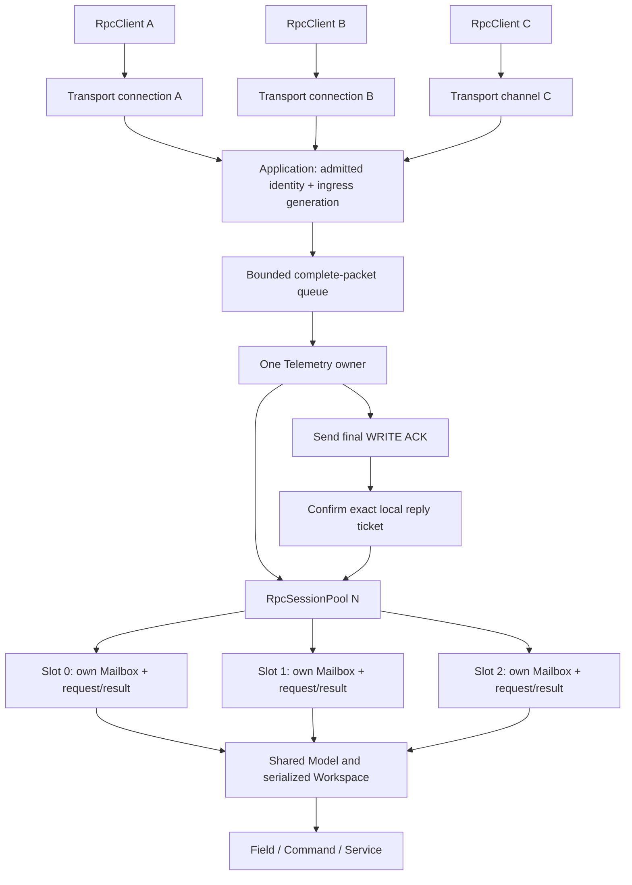

# RpcSessionPool v1: незалежні серверні сеанси

[Документація](README.md) · [Клієнт](RpcClientV1.md) · [Mailbox](RpcMailboxV1.md) ·
[Приклад N сеансів](../examples/rpc_multi_session/README.md)

## Архітектура

`RpcMailbox` залишається станом одного вхідного RPC-сеансу. Optional
`RpcSessionPool<N>` керує належністю N вже сконструйованих mailbox-ів.
Pool не створює Model, буферів, мережі, задач чи mutex. Один owner послідовно
обробляє пакети й виклики `process()`; application володіє admission,
framing, чергами, connection generation і синхронізацією своїх даних.



RpcClient володіє вихідною транзакцією, RpcMailbox — вхідною транзакцією,
Pool — server-side належністю slot. Жодна з цих сутностей не є транспортом.
Усі три працюють із чинними Resource v1 і RPC v1.0 bytes.

## Статичні bindings

```cpp
#include <integration/telemetry/v3/RpcSessionPool.hpp>
namespace rpc = resource::telemetry::v3;

// mailboxA/B, їхні buffers та filesA/B створено заздалегідь.
std::array bindings{
    rpc::RpcSessionBinding{mailboxA, filesA.view(), 0},
    rpc::RpcSessionBinding{mailboxB, filesB.view(), 0},
};
rpc::RpcSessionPool<2> sessions{bindings};
```

Pool копіює тільки bounded metadata bindings; mailbox-и не копіюються й
не переміщуються. Вони, ModelView, таблиці файлів, providers, назви,
request/result storage та Workspace живуть за стабільними адресами довше
за pool/виклики. Сам pool також non-copyable/non-movable.

Кожна binding містить mailbox, FileSystemView та FileIndex RPC-файла.
`files[rpcFile]` має посилатися **саме на цей mailbox**. Це precondition
application: private erased provider pointers не відкриваються для інспекції.
Конструктор перевіряє доступність індексу, read/write capabilities та
відсутність повторно зареєстрованого mailbox без виклику `size()` providers.
Він відхиляє Running mailbox та викликає `resetSession()` для кожного binding:
Ready/Pending/result/high-water попереднього власника не зберігаються. Відтоді
цими mailbox-ами керує лише цей pool; паралельний прямий доступ неприпустимий.

Кожен сеанс може мати той самий path `/telemetry/rpc.bin` та FileIndex 0,
але окремий provider. Спільні readonly Descriptor/Values/custom files можуть
бути присутні в усіх file tables. FileSystem не стає global mutable registry.
Pool допускає різні ModelView для різних mailbox-ів; спільний Model не є вимогою.

## Public API

| API | Призначення |
| --- | --- |
| `RpcSessionBinding(mailbox, files, rpcFile=0)` | Зв'язати стабільні provider і file table |
| `RpcSessionPool<N>(bindings)` | Скопіювати N bindings, без копіювання mailbox |
| `acquire(RpcConnectionKey)` | Повернути `{status, session}`: Ok/Existing/NoCapacity/Reentrant |
| `valid(handle)` | Перевірити owner, slot, generation і connection key |
| `handle(handle, request, response)` | Обробити повний Resource packet |
| `replyAccepted(handle, ticket)` | Відкрити dispatch gate конкретного final ACK |
| `process(nowMs, maxCallbacks=1)` | Оновити tick і виконати bounded dispatch |
| `release(handle)` | Відразу інвалідовувати handle, завершити або відкласти reset |

`RpcSessionHandleResult` зберігає pool status, окремий Resource reply і ticket.
`RpcSessionProcessResult` повертає status, `visited` та `dispatched`.
Не підміняйте Resource status статусом pool: успішний доступ до slot ще не
означає успішну file operation або application callback.

## Admission, handle та generation

Application спочатку встановлює підтверджений connection context та одноразово
узгоджує schema. Лише потім викликає `acquire(connectionKey)`. Key розрізняє
peer, connection generation і channel; це local metadata з ingress, не довільне
поле мережевого payload.

Handle прив'язаний до конкретного pool, slot і generation цього використання.
Після release він більше не проходить valid/handle/ACK навіть при видачі slot
новому peer. Slot generation та reply ticket не загортаються: slot вичерпує
reuse, а не дозволяє ABA. Власник pool не допускає використання handles після
знищення самого pool чи його backing resources.

Повторне acquire чинного connection key не створює другий прихований mailbox.
Кілька паралельних каналів одного peer отримують різні channel key. Pool
працює з уже допущеними keys, а не з необмеженою історією всіх peer: повторний
admission старого connection key після disconnect забороняє application.

Якщо всі N slots зайняті/Closing/exhausted, новий клієнт отримує чітку
відмову. Ready і Running sessions автоматично не витісняються.

## Приймання пакета й ACK до callback

1. Ingress прив'язує packet до connection generation під час приймання.
2. Owner перевіряє handle і передає повний Resource packet до `handle()`.
3. Метод викликає чинний Resource Protocol через slot-specific FileSystem.
   Він не виконує Pending callback.
4. Для прийнятого final WRITE ACK повертається local reply ticket.
5. Application передає весь ACK транспортові. Тільки після підтвердженої
   повної передачі повідомляє `replyAccepted(handle, ticket)`.
6. Наступний `process(nowMs, budget)` може виконати цей Pending mailbox.

Ticket прив'язаний до owner/slot/generation і конкретної відповіді. ACK іншого
slot, старої generation чи іншої Resource operation не відкриває gate.
Невдала/часткова передача ACK не відкриває gate. Лише успішний final WRITE
у Pending створює ненульовий ticket; Ready replay його не потребує.
Новий Pending retry замінює попередній непідтверджений ticket. READ і
відхилений WRITE його зберігають. Gate, уже відкритий попереднім прийнятим
ACK тієї самої транзакції, наступним retry не закривається.
Вичерпаний ticket counter дає Exhausted при новому final WRITE;
доступ до готового результату через READ лишається можливим.

`replyAccepted` означає узгоджену точку handoff у вашому transport, а не доказ
отримання клієнтом. Саме тому втрата ACK закривається ідентичним WRITE retry.
Для UART DMA викликайте confirmation після передачі повного ACK, коли цього
вимагає ваш порядок; для TCP визначте, що саме означає accepted reply у owner.
Не підтверджуйте відповідь до того, як transport реально прийняв її bytes.

## Scheduling і reentry

`process(nowMs, budget)` має bounded round-robin обхід. За замовчуванням
допускається один callback за виклик, максимум — N. Non-Pending mailbox-и
отримують актуальний tick, щоб Receiving timeout працював незалежно від
чиїхось Pending/Ready. Held Pending не викликає `mailbox.process()` до ACK gate.

`handle()` не приймає час. Якщо `process()` виконав callback, перед наступним
ingress отримайте свіжий tick і викличте `process(freshNow, 0)`, щоб час,
витрачений усередині callback, не перетворився на застарілий Receiving tick.

Довгий synchronous callback блокує одного owner до повернення. Pool не
забезпечує preemption і не є RTOS scheduler. Рекурсивні process/handle/acquire
під час callback відхиляються. Release поточного Running slot дозволений
як відкладене закриття; це не виклик другого callback.

Один спільний Workspace допустимий тільки за serialized dispatch. Будь-які
native виклики з інших задач, зміни application state та lifetime borrowed
`const T&` синхронізує application. Для borrowed output referent захищено
до завершення encode, а не лише до повернення getter.

## Release

Порядок закриття:

1. Заборонити ingress старого connection.
2. Відкидати стару generation у queued packets та пізніх ingress callbacks.
3. Викликати `release(handle)`, який одразу інвалідовує старі handle/tickets.
4. Якщо mailbox не Running — `resetSession()` очищує request/result/high-water.
5. Якщо Running — slot залишається Closing; після callback reset виконується
   перед будь-яким повторним використанням.

Чинний `RpcMailbox::resetSession()` у Running залишається no-op. Pool не
змінює це правило і не віддає Closing slot новому клієнту. Pending можна
скасувати до callback. Після розриву client може мати `OutcomeUnknown`:
release не доводить, що раніше передана дія не виконалась.

## Пам'ять: N=4

Наприклад, application обрала request capacity 1 048 bytes, result payload
capacity 4 096 bytes, shared Workspace 4 112 bytes і два packet buffers
по 256 bytes. Тоді самі byte buffers займають:

```text
4 * (1048 + 4096) + 4112 + 2 * 256 = 25 200 bytes
```

Окремо додаються `4 * sizeof(RpcMailbox)`, `sizeof(RpcSessionPool<4>)`,
таблиці файлів, Model/views та transport queue. Ці `sizeof` залежать від
ABI/toolchain; не підміняйте їх універсальними числами. Бюджет request
включає 24-byte TRPC header, result capacity не включає 32-byte wire header.
N=4 є прикладом, а не межею бібліотеки.

Offline Cortex-M7 compile/objdump на CubeIDE GCC 14.3.1 для поточної
реалізації показав `sizeof(RpcMailbox)=56`, `sizeof(RpcSessionBinding)=16`,
`sizeof(RpcSessionPool<1>)=52`, `<2>=96`, `<4>=184` bytes. Це розміри об'єктів
на цьому ABI, без request/result storage і без вимірювання часу на платі.

## Qualification та інтеграція

[Session suite](../tests/structured/rpc_sessions/README.md) перевіряє N=1/2/4,
одночасний tx=1, ізольовані results, покоління, ticket ordering, Closing,
reentry та спільний serialized Workspace. [Runnable example](../examples/rpc_multi_session/main.cpp)
передає справжні Resource bytes і показує як незалежні connections, так і
зовнішнє multiplexing. Host fake transport не є вимірюванням UART DMA/TCP.

Усі new-component hardware тести — окремий наступний доказ. Цей зріз
не перепрошиває плату, не змінює старі receipts і не обіцяє exactly-once
після reboot/reconnect. Деталі backing packet protocol — у
[Resource protocol](../lib/resource/protocol/README.md).
