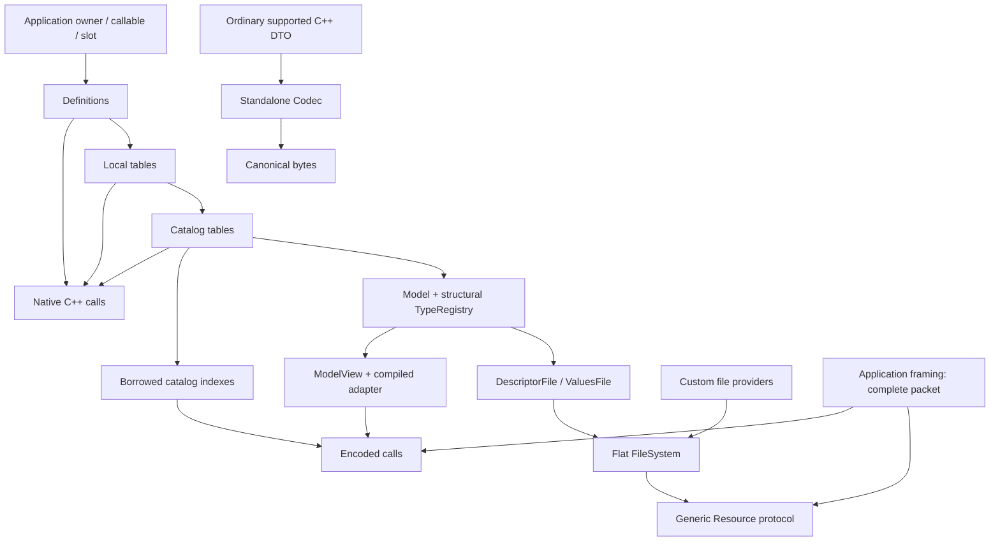

# API Map: Native, Encoded, Codec і Resource

[Репозиторій](../../README.md) · [Посібник](README.md) ·
[Перша інтеграція](GettingStarted.md) · [Шпаргалка](API-CHEATSHEET.md)

Оберіть маршрут за тим, що вже маєте у місці виклику. Це чотири способи
користуватися наявною бібліотекою; вони можуть співіснувати в одному застосунку.
Model/Definitions нижче — спільна основа для endpoints та їхнього опису,
а не обов'язковий runtime шар перед кожним викликом.

## Вибір за хвилину

| У вас є / потрібно | API | Необхідні об'єкти | Канонічний довідник | Повна програма |
| --- | --- | --- | --- | --- |
| C++ значення; читати Field, виконати Command або викликати Service | **Native** | Owner/binding + definitions; local tables за потреби, catalogs для global IDs | [Native API](NativeApi.md) | [NativeOnly.cpp](../../examples/user_guide/NativeOnly.cpp) |
| Runtime ID + canonical payload bytes | **Encoded** | Catalog index **або** ModelView; input/output buffers і Workspace | [Encoded access](Model.md#encoded-api-catalog-index-або-modelview) | [Encoded.cpp](../../examples/user_guide/Encoded.cpp) |
| Самостійно перетворити DTO ↔ bytes, без endpoints | **Codec** | C++ object і byte span; Workspace лише для construction у scratch | [Codec and Workspace](CodecAndWorkspace.md) | [Codec.cpp](../../examples/user_guide/Codec.cpp) |
| Названі файли, порційний READ/WRITE або LIST/STAT | **Resource** | Stable providers/paths + FileSystem; protocol за потреби | [Resource files](Resources.md) | [Resources.cpp](../../examples/user_guide/Resources.cpp) |
| Зібрати спільний structural registry і опис endpoints | **Model / Definitions** | Owner → definitions → tables → catalogs → Model | [Model](Model.md) | [QuickStart.cpp](../../examples/user_guide/QuickStart.cpp) |

Перший приклад Native не створює Model, Workspace чи files. Standalone Codec
не потребує навіть Field/Command/Service. Generic Resource працює без telemetry;
Descriptor/Values — окремі providers, які додаються за потреби.

Для віддаленого доступу оберіть клієнт над цими API:

| Сценарій | Точка входу |
| --- | --- |
| Відомі DTO та Codec, асинхронні виклики через Encoded або RPC | [DeviceClient](../AsyncClient.md); Generated SDK необов'язковий |
| Типи й endpoints отримано з Descriptor під час роботи | [DynamicClient](../DynamicClientUsage.md), [RuntimeSchema](../RuntimeSchema.md) |
| Готовий read-only GUI для невідомого пристрою | [Qt/QML Inspector](../../examples/inspector_qml/README.md) |
| Потрібен лише низькорівневий RPC packet engine | [RpcClient](../RpcClientV1.md) |

На сервері [RpcSessionPool](../RpcSessionsV1.md) керує N окремими mailbox-ами.
Application передає повні frames і час, підтверджує handoff та зіставляє replies.
Descriptor описує структуру; live значення можна читати через Encoded FieldRead.
Resource Values provider є окремим варіантом, а не обов'язковим каналом даних.

## Залежності та точки входу



Catalogs об'єднують local tables. Вони дають global PackedId та `index()`.
Local `FieldTable`, `CommandTable` і `ServiceTable` не мають `index()`;
їхні erased rows доступні через `operator[]`, а native definition — через
`get`/`visit`. Model збирає один structural TypeRegistry і runtime views.
Вона не є owner даних і не замінює native API таблиць/каталогів.

Нижче короткі fragments викликів. Змінні `fields`, `commands`, `services`
означають відповідні local tables у Native розділі та catalog tables в Encoded
розділі. Повні declarations і `main()` є у linked runnable programs.

## Native: C++ значення без byte buffers

```cpp
const auto value = fields.read<0>();             // Compile-time local position.
const auto write = fields.write<0>(newValue);    // Exact native value.
const auto action = commands.call<0>();
const auto reply = services.call<0>(request);

const auto converted = fields.readAs<std::uint32_t>(position);
const auto applied = fields.writeAs(position, newValue);
const auto called = commands.call(position, request);
const auto response = services.callAs<Reply>(position, request);
```

Зіставте request із реальною сигнатурою callback: Command/Service має нуль
або один aggregate Request. Runtime Command використовує `call(position)`
або `call(position, request)`. Runtime Service — `callAs<Reply>(position)`
або `callAs<Reply>(position, request)`; для borrowed response є `callBorrowed`.

- Static positions/IDs зберігають exact definition та native result type.
- Runtime Field `readAs`/`writeAs` підтримують визначені **checked conversions**;
  struct/array access вимагає exact type. Для причини read відмови є
  `readAsResult<T>`.
- Runtime Command/Service вимагає **exact request/response signature**.
  Однаковий layout двох DTO не робить їх тим самим C++ типом.
- Borrowed `const T&` Field читається без копії через `read()` або
  `readBorrowed<T>`; Service має `callBorrowed<T>`. `readAs<T>` повертає owning copy.
- `get<Position>()`, typed `forEach` та runtime `visit` працюють із definitions;
  traversal сам не запускає getter/callback. Range-for повертає erased metadata.

Результат перевіряйте перед доступом до payload. Зберігайте owning result
в іменованій змінній, поки користуєтеся його reference/pointer. Borrowed result
не подовжує lifetime application object і не гарантує snapshot чи синхронізацію.

**Деталі:** [Fields](Fields.md), [Commands](Commands.md), [Services](Services.md),
[Tables/Catalogs та iteration](TablesAndCatalogs.md),
[результати Native](NativeApi.md#14-status-результат-власника-та-dispatch--різні-рівні),
[flat runtime outcomes](FlatNative.md).

## Encoded: ID + payload

Два чинні входи використовують ті самі checked endpoint boundaries.

**Catalog indexes, без створення Model:**

```cpp
auto fieldIndex = fields.index();       // FieldCatalogTable.
auto commandIndex = commands.index();   // CommandCatalogTable.
auto serviceIndex = services.index();   // ServiceCatalogTable.

auto read = fieldIndex.readEncoded(fieldId, output, workspace);
auto write = fieldIndex.writeEncoded(fieldId, input, workspace);
auto execute = commandIndex.executeEncoded(commandId, input, workspace);
auto call = serviceIndex.callEncoded(serviceId, input, output, workspace);
```

**ModelView, для прихованих у `.cpp` таблиць і compiled forwarding:**

```cpp
auto read = telemetry::readFieldEncoded(view, fieldId, output, workspace);
auto write = telemetry::writeFieldEncoded(view, fieldId, input, workspace);
auto execute = telemetry::executeCommandEncoded(view, commandId, input, workspace);
auto call = telemetry::callServiceEncoded(view, serviceId, input, output, workspace);
```

`view` зазвичай отримують через `model.view()`. ModelView позичає indexes і
metadata; transport може отримувати цю маленьку view через application facade.
Runtime PackedId — u32: high 16 bits catalog, low 16 bits entry. Адресні простори
Field/Command/Service окремі. Lookup перевіряє межі й прямо індексує масиви.

Спочатку перевірте `dispatch`, потім application outcome там, де він існує:

| Result | Фактичні поля |
| --- | --- |
| `EncodedReadResult` | `dispatch`, `written` |
| `EncodedWriteResult` | `dispatch`, `endpointStatus` типу `WriteResult` |
| `EncodedCommandResult` | `dispatch`, `endpointStatus` типу `CommandResult` |
| `EncodedCallResult` | `dispatch`, `endpointStatus` типу `ServiceStatus`, `written` |

Input має exact wire length; output є capacity і може бути більшим за payload.
`dispatch == Ok` не означає application success. Wire decode не виконує
прикладну перевірку допустимості напруги, періоду чи режиму — це callback.
Для local-storage endpoint Workspace не використовується; інтерфейс усе одно
приймає його. Scratch sizing, status precedence й overlap описані в
[канонічному Encoded довіднику](Model.md#encoded-api-catalog-index-або-modelview).

Encoded не встановлює UART/TCP framing, reply envelope, retries чи delivery.
Передайте вже складений payload; використовуйте
[transport walkthrough](TransportWalkthrough.md) та
[повний receiver example](../../examples/device_integration/README.md).

## Codec: самостійні DTO ↔ bytes

```cpp
auto encoded = telemetry::encode(object, bytes);
auto populated = telemetry::decode(bytes, existingObject);
auto decoded = telemetry::decode<Payload>(bytes, workspace);
auto constructed = telemetry::decode(bytes, lease, pointer);
```

Перші два повертають `CodecStatus`: ви вже маєте object. Третій повертає
scope-bound `Decoded<Payload>`: він конструює object у caller Workspace і
тримає його Lease живим. Четвертий повертає `CodecStatus`; `lease` — вже
зарезервований `Workspace::Lease<Payload>`, а `pointer` — output pointer.
Повні declarations усіх трьох decode форм є в [Codec.cpp](../../examples/user_guide/Codec.cpp).

`wireSize<T>` — довжина canonical payload, не `sizeof(T)`. Members/array
elements йдуть у declaration/element order, integers та float bits — little-endian,
native padding не передається. Reflection виконується при компіляції; можна
кодувати nested aggregates і `std::array` підтримуваних типів без Model чи registry.

Standalone encode/decode вимагають exact byte-span length. Decode перевіряє
representation (зокрема bool), а application перевіряє зміст. Existing-object
decode завершує validation до mutation. References із `Decoded<T>` живуть
лише разом із named result; leases звільняються LIFO.

**Деталі:** [Codec and Workspace](CodecAndWorkspace.md),
[supported wire types та enums](Model.md).

## Resource: файли з власними paths/providers

```cpp
auto fs = resource::filesystem(
    resource::file("/settings.bin", settings),
    resource::file("/log.bin", logger));

for (auto file : fs) {
    const auto path = file.path();
    const auto stat = file.stat(); // Explicit: iteration itself does not call size().
}
auto chunk = fs[0].read(cursor, output);
auto response = resource::protocol::process(fs.view(), packet, reply);
```

`settings` та `logger` — stable provider lvalues з `size()` і щонайменше одним
із `read()`/`write()`. `file()` створює FileEntry; public operations надає FileView.
FileSystem зберігає flat entries, а не application provider objects.
Providers і paths мають жити довше за використання entries/views.

Cursor — **opaque u64 provider state**. Продовжуйте з `next`, поверненого
provider; не додавайте кількість bytes самі, якщо контракт provider цього
не визначає. Byte offset є конкретною політикою BytesFile/інших providers.
Generic packet processor отримує один повний packet; частковий transfer файла
й частковий UART/TCP frame — різні рівні.

Telemetry integration додає [DescriptorFile / ValuesFile](DescriptorAndValues.md)
до того самого filesystem. Для generic settings/logger файлів Model не потрібна.
Fingerprint описує telemetry descriptor identity, не checksum live values
або ваших довільних файлів. `WRITE final` і persistence визначає provider.

**Деталі:** [Resource files](Resources.md), [packet envelopes](../../lib/resource/protocol/README.md),
[client builders/parsers](TransportAndResources.md#клієнт-зібрати-request-і-перевірити-response),
[COBS integration](COBSIntegration.md).

## Model / Definitions: спільна основа

```cpp
inline constexpr telemetry::Model model{fields, commands, services};
auto view = model.view();
auto types = model.types();
constexpr auto typeId = model.typeId<Config>();
```

Тут `fields`, `commands`, `services` — catalog tables. Definition прив'язує
назву до getter/setter/callable; table зберігає concrete definitions і erased
rows; catalogs вводять global positions; Model об'єднує типи в один registry.
Всі ці borrowed зв'язки мають зберігати lifetime своїх sources.

TypeRegistry описує structural shape, а не units, limits, defaults чи persistence.
`RootTypes` зберігає positional roots із повторами; deduplicated registry roots
не змінюють кількість Fields або Values tokens. Для application API
користуйтеся таблицями/каталогами, `model.types()` і `model.typeId<T>()`.

**Деталі:** [Model](Model.md), [Tables/Catalogs](TablesAndCatalogs.md),
[bindings/slots](NativeApi.md), [architecture](../Architecture.md).

## Headers і compiled sources

Вказуйте include roots `lib`, `lib/boost_pfr/include`, `lib/magic_enum` для
telemetry C++20 API. Generic Resource потребує лише `lib`.

| Сценарій | Public include | Compiled sources |
| --- | --- | --- |
| Native declarations/calls | `<telemetry/Telemetry.hpp>`; окремі `<telemetry/field/FieldTable.hpp>`, `<telemetry/command/CommandTable.hpp>`, `<telemetry/service/ServiceTable.hpp>` | Самі template calls header-only; explicit ABI guard потребує `lib/telemetry/abi/StructuredAbi.cpp` |
| Encoded через catalog index | `<telemetry/field/FieldCatalogs.hpp>`, `<telemetry/command/CommandCatalogs.hpp>`, `<telemetry/service/ServiceCatalogs.hpp>` | Header-only index calls; compiled adapter не потрібний |
| Encoded через ModelView | `<telemetry/model/Adapter.hpp>`; Model declaration у `<telemetry/model/Model.hpp>` | `lib/telemetry/model/Adapter.cpp`; ABI guard — окрема залежність |
| Standalone Codec | `<telemetry/codec/Codec.hpp>` | Header-only |
| Generic files/providers | `<resource/Resource.hpp>` | Header-only |
| Resource packets | `<resource/protocol/Protocol.hpp>`; client `<resource/protocol/Packets.hpp>` | `lib/resource/protocol/Protocol.cpp` для `process()`; client helpers header-only |
| Telemetry files | `<integration/telemetry/v3/DescriptorFile.hpp>`, `<integration/telemetry/v3/ValuesFile.hpp>` | `lib/integration/telemetry/v3/detail/Values.cpp` для Values; Descriptor header-only |

Header-only тут описує compiled-source requirement. Native headers можуть
транзитивно включати codec/type/reflection headers; це не обіцянка автоматичного
зменшення Flash. Стандартний `telemetry.pri` включає обидва telemetry `.cpp`;
не додавайте їх двічі. ABI configuration має збігатися між translation units;
точний [ABI boundary contract](Model.md) не є перевіркою fingerprint у пакеті.

## API → довідник → приклад → перевірка

| API | Канонічний документ | Runnable example | Validation |
| --- | --- | --- | --- |
| Native | [NativeApi.md](NativeApi.md) | [NativeOnly.cpp](../../examples/user_guide/NativeOnly.cpp), [Native.cpp](../../examples/user_guide/Native.cpp) | `tests/docs/run.py`: execute обидва; NativeOnly має counted checks |
| Encoded | [Model.md](Model.md#encoded-api-catalog-index-або-modelview) | [Encoded.cpp](../../examples/user_guide/Encoded.cpp) | Той самий runner: callbacks, exact lengths, refusals, large/borrowed responses |
| Codec | [CodecAndWorkspace.md](CodecAndWorkspace.md) | [Codec.cpp](../../examples/user_guide/Codec.cpp) | Той самий runner: golden bytes, три decode forms, validation, lifetime/LIFO |
| Resource | [Resources.md](Resources.md) | [Resources.cpp](../../examples/user_guide/Resources.cpp), [ResourceClient.cpp](../../examples/user_guide/ResourceClient.cpp) | Той самий runner: provider operations, packet processing, client parsing |
| Model / Definitions | [Model.md](Model.md) | [QuickStart.cpp](../../examples/user_guide/QuickStart.cpp) | Той самий runner: declarations/native calls + exact README/source parity |

Команда з кореня репозиторію:

```sh
python tests/docs/run.py --cxx g++ --build-dir /tmp/telemetry-doc-examples
```

[Runner documentation](../../tests/docs/README.md) містить фактичні перевірені
toolchain modes, результати та межі доказу. Host execution, sanitizer execution
і ARM compile/link — різні перевірки; ARM docs runner не запускає плату.
